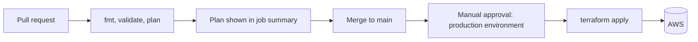

# Terraform CI/CD Pipeline with GitHub Actions

A small, working example of deploying AWS infrastructure with Terraform through GitHub Actions: changes are planned on pull requests, applied on merge to `main` after a manual approval, and AWS access uses short-lived OIDC credentials, so no access keys are stored in GitHub.

## How it works

1. **Pull request:** the `terraform-plan` workflow runs `fmt -check`, `validate`, and `plan`, and writes the plan to the job summary so it can be reviewed before merging.
2. **Merge to `main`:** the `terraform-apply` workflow starts, then pauses until a reviewer approves the `production` environment.
3. **Apply:** after approval, Terraform applies the change using the same state stored in S3.

## Repository layout

| Path | Purpose |
|------|---------|
| `bootstrap/` | One-time setup, run locally: S3 state bucket, GitHub OIDC provider, and the IAM role the pipeline assumes |
| `infra/` | The infrastructure the pipeline manages (a demo S3 bucket with versioning, encryption, and public access blocked) |
| `.github/workflows/` | `terraform-plan.yml` (pull requests) and `terraform-apply.yml` (main, with approval) |

## Security design

- **No stored AWS keys.** GitHub authenticates to AWS with OIDC and receives temporary credentials.
- **Scoped trust.** The IAM role can only be assumed by this repository, either from a pull request or from the `production` environment.
- **Least privilege.** The role can read and write the state bucket and manage only buckets with the demo prefix.
- **Manual approval.** Nothing is applied until a reviewer approves the `production` environment.
- **Safe state.** Remote state in a versioned, encrypted, private S3 bucket, with S3 native locking (`use_lockfile`, Terraform 1.10 or later).
- **One apply at a time.** A concurrency group prevents overlapping applies.

## Setup

1. Edit the bucket names and repository in `bootstrap/main.tf` to match your own, then from `bootstrap/` run `terraform init` and `terraform apply`.
2. In the GitHub repo, add a variable named `AWS_ROLE_ARN` set to the role ARN that bootstrap outputs.
3. Create a GitHub environment named `production` and add yourself as a required reviewer.
4. Point the backend block in `infra/main.tf` at your state bucket.
5. Push to `main`, then approve the deployment in the Actions tab.

## Known limitations and next steps

- Plan and apply currently share one role. A read-only role for pull request plans would be tighter.
- Add a security scan step, such as Trivy or Checkov, before plan.
- Pin third-party actions to commit SHAs.
- Add branch protection that requires the plan check to pass before merging.
